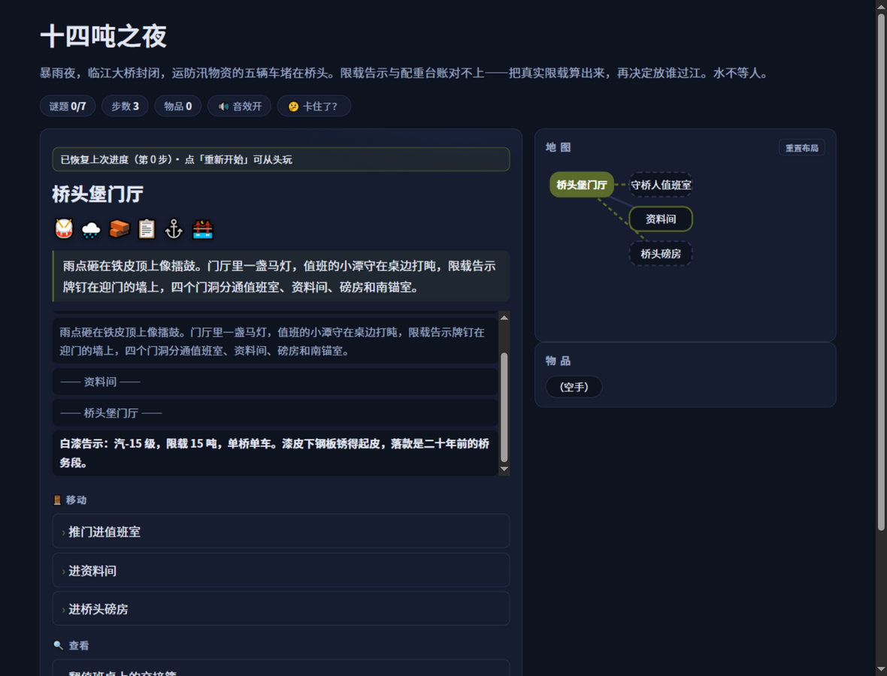
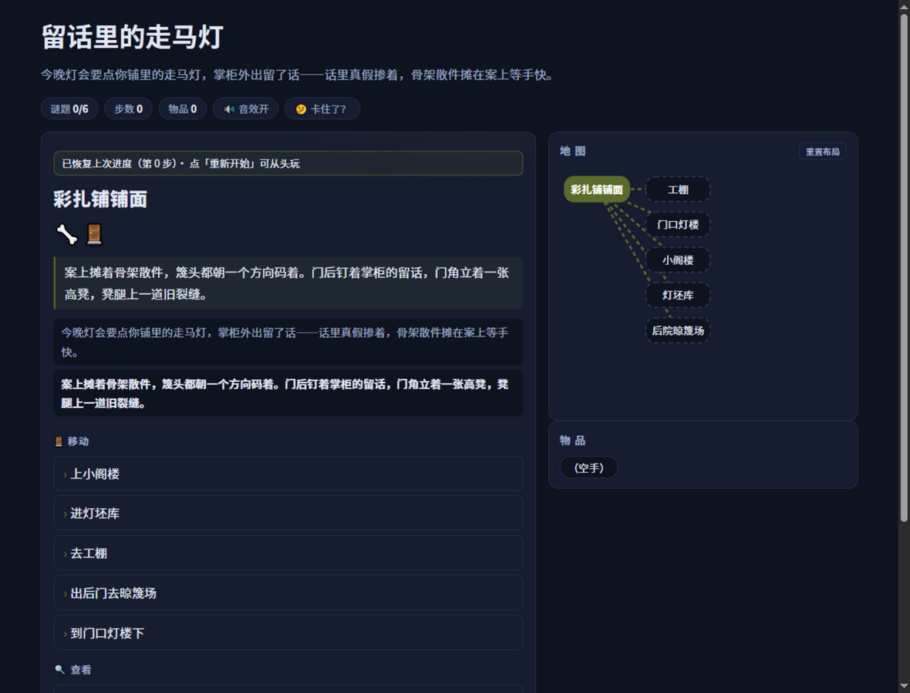

# 🧩 文字密室逃脱关卡库

> **48 个可玩的中文文字密室关卡 · 可视化游戏引擎 · 完整的 AI 生产流水线**
> 每关都通过「可通关 / 无软锁 / 线索先行 / 解法唯一 / 难度区间」等七项程序化校验，并经过 96 场双风格 AI 试玩与两轮评审回炉。


目录页即游戏启动器：每张卡片标注难度、机制、评审五维分、试玩战绩，点击标题直接开玩。

## 🎮 立即游玩

| 方式 | 说明 |
|---|---|
| **本地服务** | 项目目录运行 `node tools/dev-server.js . 8899`，访问 `http://127.0.0.1:8899/`，从目录页点入任意关卡 |
| **单文件直开** | 双击任意 `games/<关卡>/index.html` —— 数据已内嵌，无需服务器 |



## ✨ 引擎特性（纯表现层，不改动游戏数据）

- **舞台区**：房间名 + 按房间内容自动匹配的 emoji 场景条 + 强调色叙事块 + 分条日志
- **自动地图**：走过的房间实心、当前房间高亮、相邻未去虚线；**节点可拖拽**，布局按关卡自动存档，"重置布局"一键还原
- **动作三分组**：🚪 移动 / 🔍 查看 / 🛠️ 行动，长列表一眼扫清；支持数字键 1-9 快速触发
- **自动存档续玩**：刷新/退出后自动恢复进度；通关记入最佳步数与用时，回显到目录页徽章
- **"卡住了？"轻提示**：只指出没细看的地方和没去过的邻室，不揭答案
- **音效**：移动/查看/解谜/通关四种 WebAudio 合成音，可静音，零外部资源

## 🏆 通关复盘

通关瞬间会在浏览器内跑一次状态空间搜索，结算面板给出**本局步数 vs 理论最短步数**的评级（完美路线🏆 / 干净利落⭐ / 曲径通幽🧭），并在地图上标注你的探索顺序（数字）与理论最短路线（绿线）。


## 🕹️ 每一关都要过七道质量门

| 检查 | 内容 |
|---|---|
| 结构完整 | 引用的房间/物品存在、动作 ID 唯一、标志 ≤20 |
| 可通关 | 存在到达胜利结局的路径 |
| 无死局与软锁 | 全部可达状态均仍能通关（全状态空间遍历） |
| 无孤儿内容 | 每个动作会被触发、每个物品可获得、每个房间可达 |
| 线索先于谜题 | 每个谜题都存在"已获线索、未解"的状态 |
| 解法唯一 | 每个谜题恰有一个解法动作 |
| 难度区间 | 最短步数与平均分支落在难度带内 |

之外还有：双风格试玩（谨慎型必须通关，卡住>25步强制回炉补线索）、句子重合度去重（阈值 0.30）、五维评审（谜题推理感/线索自然度/文字质量/主题呼应/结局回报，逐维引用原文）。

**当前水位**：评审均分 **23.67 / 25**（满分关 13 个）· 谨慎型试玩 **48/48 通关、零卡点** · 全库句子重合度实测 <0.10

## 🏭 生产流水线

1. **引擎抽取**：从手写样板抽出引擎与校验器，定稿后不再修改
2. **种子设计**：48 个种子（场景唯一、机制组合滑窗唯一、难度三档）
3. **关卡生成**：概念 → 依赖图（查环）→ game.json → 校验（≤5 轮）→ 打包
4. **AI 试玩**：谨慎型 / 乱试型两种风格各一局，卡点回炉补线索
5. **评审**：五维量表引用原文打分，缺陷回炉至收敛
6. **去重**：句子重合度比对，维护 banned.md 禁用清单



## 🗂️ 目录结构

```
INDEX.json            48 关全量汇总（按评审分排序）
index.html            关卡目录页（tools/build-index-page.js 生成）
engine/play.html      可视化引擎（定稿未改；旧版备份 play-classic.html）
build.js              打包器：node build.js <game.json> [out.html]
seeds.json            48 个种子
games/g01..g48/       concept · depgraph · game.json · index.html ·
                      gen-notes · playtest-*.json · review.json
games/_spec/          生成规范 + banned.md 禁用清单
tools/                validate.js · play.js · dedup.js · build-index-page.js · dev-server.js
reports/              生产报告 · 丰富阶段报告 · 试玩/去重总账
```

## 🛠️ 想加一关？

1. 在 `seeds.json` 按规则追加种子（机制组合不与前三个重复、场景唯一）
2. 通读 `games/_spec/GENERATION-SPEC.md` 与 `games/_spec/banned.md`
3. 按"概念 → 依赖图 → game.json → validate → build"走完，目录页重新生成即可

## 📄 说明

- 所有关卡文本与代码由 AI 生产，人类负责验收与决策
- 引擎语义与 `tools/validate.js` 是全库质量的锚点，欢迎按同规格扩展
